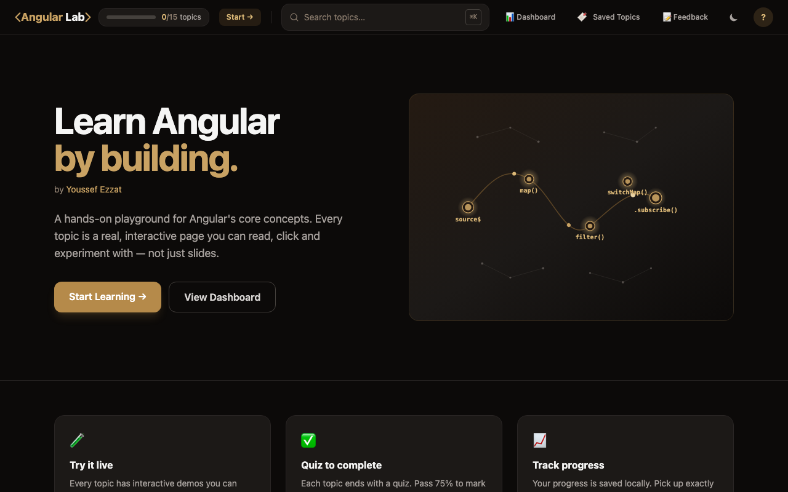
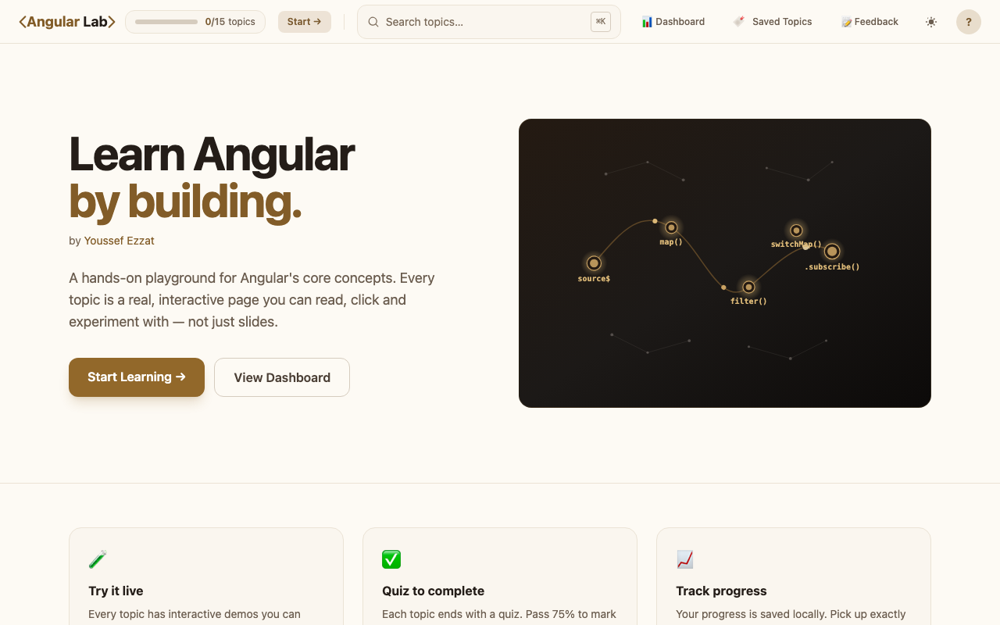
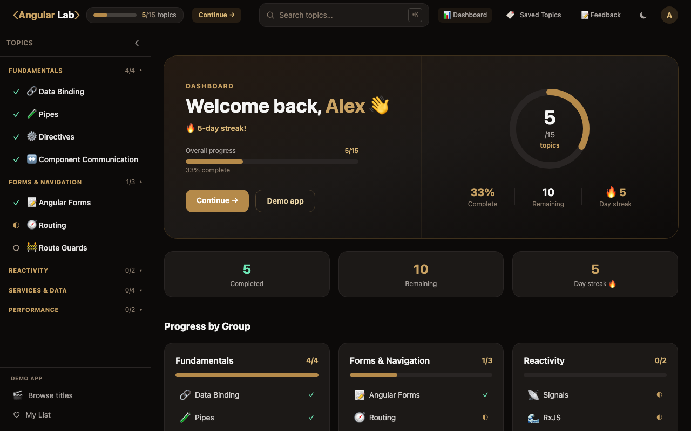
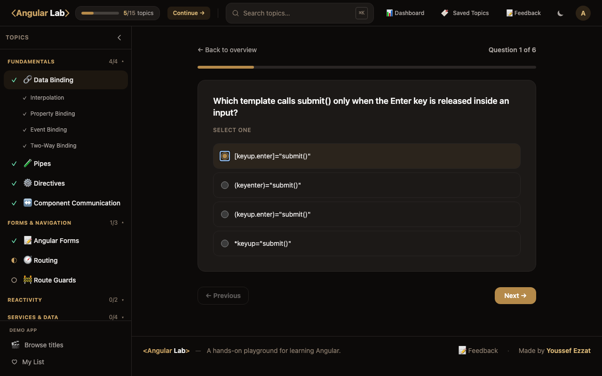
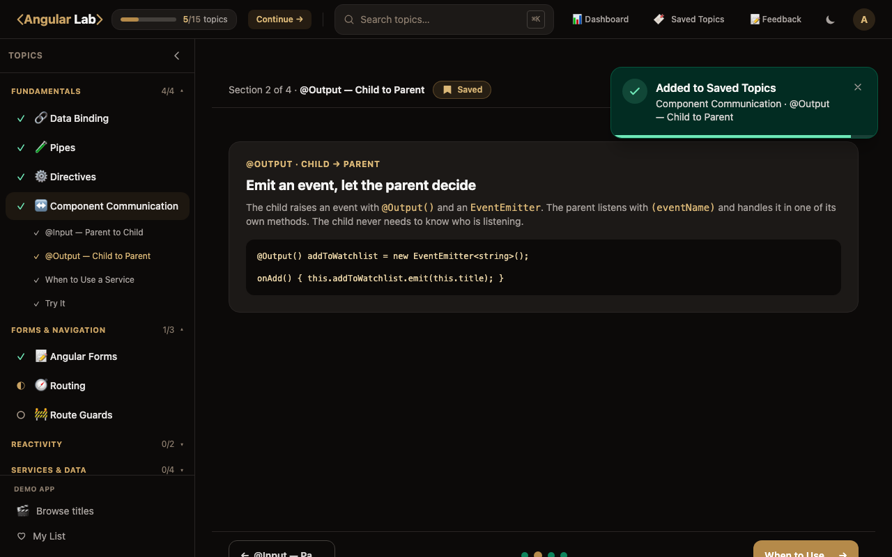
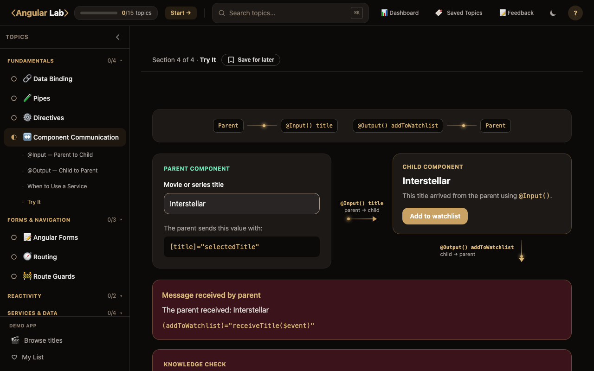
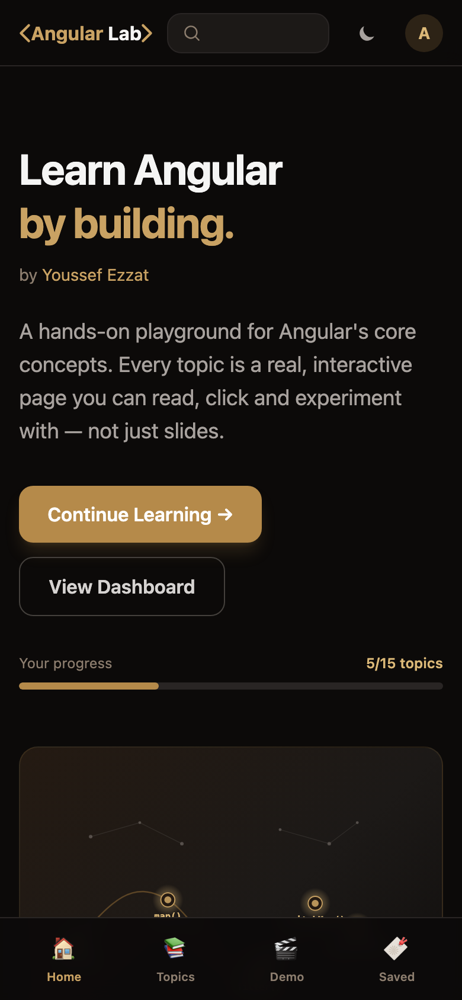
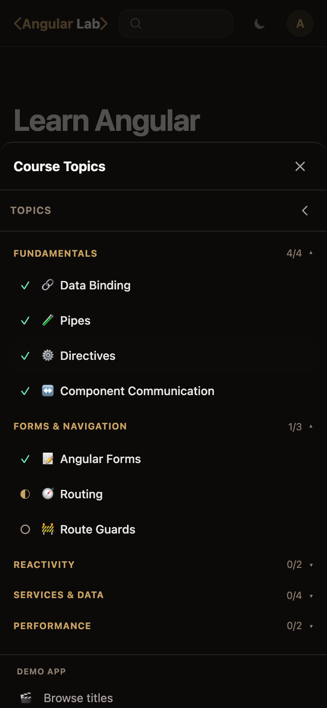

<div align="center">

# Angular Lab

**A hands-on playground for learning Angular — every core concept as a live, interactive page, not a slide.**

[**Live demo →**](https://youssefezzat17.github.io/angular-lab/)


[](https://github.com/YoussefEzzat17/angular-lab/actions/workflows/deploy-github-pages.yml)




</div>

---

## Overview

Angular Lab teaches Angular through **18 lessons**. Each lesson is split into short sections and closed by a final quiz. Each one explains *why* a concept exists and what problem it solves, shows a small animated diagram of what is actually happening, and gives you a live example you can click, edit and watch update in the browser. A small movie-and-series **demo app** shows several of these concepts working together in one real feature.

It is built with modern Angular only: standalone components, signals, the `@if` / `@for` / `@switch` control flow and signal inputs — no NgModules. There is no backend; everything runs in the browser.

## Features

<table>
  <tr>
    <td width="33%" valign="top">
      <b>📚 Interactive lessons</b><br>
      18 lessons in short sections (concept / try-it / reference), with an overview, objectives and animated diagrams.
    </td>
    <td width="33%" valign="top">
      <b>✅ Final quiz per topic</b><br>
      6 random questions drawn from a bank of 10–15, shuffled choices, 75% to pass, best score kept. Unlocks when every section is done.
    </td>
    <td width="33%" valign="top">
      <b>📈 Progress tracking</b><br>
      Sections and quiz results saved in <code>localStorage</code>; old-format progress is migrated.
    </td>
  </tr>
  <tr>
    <td width="33%" valign="top">
      <b>🔥 Dashboard</b><br>
      Welcome by name, day streak, level and XP, overall progress ring, a per-topic progress map and your latest activity.
    </td>
    <td width="33%" valign="top">
      <b>🔖 Save for later</b><br>
      Bookmark any section and find it on the Saved Topics page. Toasts confirm saves and removals.
    </td>
    <td width="33%" valign="top">
      <b>👋 Onboarding</b><br>
      A first-visit dialog asks for an optional name, then a short skippable 5-step tour shows how the app works.
    </td>
  </tr>
  <tr>
    <td width="33%" valign="top">
      <b>🧭 Sidebar &amp; mobile nav</b><br>
      Curriculum in five groups, in a collapsible sidebar (icon rail when collapsed). On phones, a bottom bar: Home, Topics (a bottom sheet), Journey, Dashboard and Saved.
    </td>
    <td width="33%" valign="top">
      <b>🌗 Light &amp; dark themes</b><br>
      Built on CSS variables. Toggle in the navbar, or follow the system preference.
    </td>
    <td width="33%" valign="top">
      <b>⌘ Command palette</b><br>
      <kbd>⌘</kbd>/<kbd>Ctrl</kbd> + <kbd>K</kbd> finds any topic, any section of a lesson, or a demo page, best match first.
    </td>
  </tr>
  <tr>
    <td width="33%" valign="top">
      <b>🎬 Demo app</b><br>
      Browse titles, a persistent Watchlist (duplicate detection, remove, clear all) and My List. Both survive a refresh.
    </td>
    <td width="33%" valign="top">
      <b>✉️ Feedback form</b><br>
      Sends a real email through <a href="https://www.emailjs.com/">EmailJS</a>, client-side with only the public key.
    </td>
    <td width="33%" valign="top">
      <b>♿ Accessible &amp; responsive</b><br>
      Keyboard navigable, every control has an accessible name (checked by tests on every page), respects <code>prefers-reduced-motion</code>, works down to phone width.
    </td>
  </tr>
  <tr>
    <td width="33%" valign="top">
      <b>🏆 XP, levels &amp; badges</b><br>
      10 XP per section, 50 for passing a quiz, 25 more for full marks. 7 levels and 8 badges, celebrated with a toast and a little confetti (loaded only when needed).
    </td>
    <td width="33%" valign="top">
      <b>🗺️ Journey map</b><br>
      Every topic as a stop on a path through five worlds, with "You are here", the XP earned in each topic and the badge wall.
    </td>
    <td width="33%" valign="top">
      <b>🕑 History</b><br>
      The last 200 things you did, grouped by day (Today, Yesterday, full dates), filtered by type or topic, shown 20 at a time.
    </td>
  </tr>
  <tr>
    <td width="33%" valign="top">
      <b>🧪 Practice widgets</b><br>
      Predict the output, put the steps in order, and live visualisers: change detection tree, DI tree and provider recipes, Subject radio station, switchMap vs. mergeMap vs. concatMap lanes, RxJS marble timelines, an interceptor chain trace, a <code>track</code> demo, and a real <code>resource()</code>.
    </td>
    <td width="33%" valign="top">
      <b>📖 Glossary</b><br>
      Tap or hover a hard word (injector, stream, OnPush…) for a plain-language explanation.
    </td>
    <td width="33%" valign="top">
      <b>🎚️ Levels &amp; prerequisites</b><br>
      Every topic shows Beginner / Intermediate / Advanced, its time, and which topics it builds on.
    </td>
  </tr>
</table>

<div align="center">


<br />
<sub><i>Dashboard · Final quiz</i></sub>
</div>

<div align="center">


<br />
<sub><i>Save for later · Component Communication lesson</i></sub>
</div>

<div align="center">


<br />
<sub><i>Mobile home · Mobile topics sheet</i></sub>
</div>

## Lessons

The lessons are grouped, and the order below is the recommended learning path (it is also what Next / Previous follow).

| Group | Topic | Route | What you learn |
| --- | --- | --- | --- |
| **Fundamentals** | Data Binding | `/learn/binding` | Interpolation, property, event and two-way binding |
| | Pipes | `/learn/pipes` | Formatting dates, prices and text, chaining pipes, a custom pipe, and why a pure pipe beats a method call (live call counter) |
| | Directives | `/learn/directives` | `@if` / `@else` / `@for`, why `track` matters (type in a row, then remove one), custom attribute directives |
| | Component Communication | `/learn/communication` | `@Input()` / `@Output()`, parent ↔ child with animated data-flow arrows |
| | Content Projection & Queries | `/learn/content-projection` | `ng-content` slots, `viewChild`, `contentChild` and a tabs component that builds itself |
| **Forms & Navigation** | Angular Forms | `/learn/forms` | Template-driven vs. reactive forms, validation, custom validators, and `touched` / `dirty` / `errors` live on a real control |
| | Routing | `/learn/routing` | Routes, `router-outlet`, `routerLink`, route parameters |
| | Route Guards | `/learn/guards` | `canActivate`, redirecting with a `UrlTree`, and the other guard kinds (live login demo) |
| **Reactivity** | Signals | `/learn/signals` | `signal()`, `computed()` (lazy and cached, with a run counter), `effect()`, `toSignal()` / `toObservable()` |
| | RxJS | `/learn/rxjs` | Observables, marble diagrams for `map` / `filter` / `debounceTime` / `take` / `scan`, `switchMap` vs. `mergeMap` vs. `concatMap`, subjects, memory leaks and `takeUntilDestroyed` |
| **Services & Data** | Dependency Injection | `/learn/di` | `inject()`, `providedIn: 'root'` vs. component `providers`, `InjectionToken` and `useClass` / `useValue` / `useFactory` on a real injector |
| | Fetch API & HTTP | `/learn/movies` | `HttpClient`, services, a real public API |
| | Resource API | `/learn/resource` | `resource()`, `rxResource()` and `httpResource()`: loading, error and cancelled requests as signals (experimental in Angular 20) |
| | HttpInterceptor | `/learn/interceptor` | One checkpoint for every request and response: reorder three real interceptors and read the trace |
| | Facade Pattern | `/learn/facade` | One simple front door over several services: build one, use it, test it, and when *not* to (live checkout demo with rollback) |
| **Performance** | Change Detection | `/learn/change-detection` | Default vs. `OnPush`, mutating vs. replacing, and why signals fit `OnPush` |
| | Lazy Loading | `/learn/lazy-loading` | `loadComponent`, smaller initial bundles, and preloading strategies compared by waiting time and background data |
| | `@defer` Blocks | `/learn/defer` | Placeholders, triggers (`viewport`, `interaction`, `timer`) and prefetching for parts of a page |

Each lesson has its own overview at `/learn/<id>`, and its sections at `/learn/<id>/<section>`. The quiz is at `/learn/<id>/quiz` and opens only after all sections are done. `/learn` opens the first lesson, and the old paths (such as `/binding`) redirect to `/learn/<id>`.

**Demo app:** `/products` (browse titles) · `/products/:id` (details) · `/watchlist` · `/favorites`. **Also:** `/dashboard` (progress), `/bookmarks` (Saved Topics), `/guards/members` (guard demo), `/feedback`. The home page is at `/`.

## Tech stack

| | |
| --- | --- |
| Framework | Angular 20 — standalone components, signals, signal inputs, new control flow |
| Language | TypeScript 5.8 |
| Styling | Tailwind CSS 3 with CSS-variable design tokens (light / dark) |
| Reactive | RxJS 7.8 and Angular Signals |
| Email | `@emailjs/browser` |
| Celebrations | `canvas-confetti`, loaded on demand |
| Testing | Jasmine + Karma |
| Hosting | GitHub Pages, deployed by GitHub Actions |

## Getting started

**Requirements:** Node.js 22+ and npm.

```bash
git clone https://github.com/YoussefEzzat17/angular-lab.git
cd angular-lab
npm install
npm start          # http://localhost:4200
```

The app reloads on every save — change a component and watch the concept it teaches update live.

| Command | What it does |
| --- | --- |
| `npm start` | Dev server on `http://localhost:4200` |
| `npm run build` | Production build into `dist/angular-lab/` |
| `npm test` | Unit tests (Karma + Jasmine). Besides unit tests it renders every lesson section and every page and audits them for accessibility |
| `npm run build:gh-pages` | Production build plus the `404.html` / `.nojekyll` files GitHub Pages needs |

### Feedback form (optional)

The feedback page sends mail through EmailJS. Its service ID, template ID and **public** key live in `src/app/core/services/feedback.service.ts`. To use your own account, replace those three values. Never put a private key in client code.

## Project structure

```text
src/app/
├── core/
│   ├── data/          topics.ts — single source of truth for every lesson (sections, objectives, level,
│   │   │              prerequisites, group) and glossary.ts — plain-language word meanings
│   │   └── quizzes/   one question bank per lesson (checked by quiz-banks.spec.ts)
│   ├── guards/        members.guard.ts — the guard used by the Route Guards lesson
│   ├── layout/        site layout for the home and 404 pages (navbar, footer), toast, command palette
│   ├── models/        learning.models.ts (topics, sections, quizzes, progress), Movie, Product, User
│   ├── onboarding/    first-visit dialog that asks for an optional name, and the welcome tour
│   └── services/      progress, quiz, learning.facade, profile, bookmark, sidebar-state,
│                      progress-migration, theme, toast, watchlist (cart), favorites,
│                      feedback, movie, product, search palette, search-index, safe-storage,
│                      gamification (+ gamification-rules: XP, levels, badges), activity-history
├── learn/             the lesson system
│   ├── layout/        learn layout with the top navbar and footer
│   ├── sidebar/       curriculum tree and sidebar parts
│   ├── player/        topic overview, lesson player, section navigation bar
│   ├── quiz/          final quiz, quiz result and topic-complete pages
│   ├── learn.routes.ts   /learn/:topic routes and the lesson page loaders
│   └── learn.guards.ts   quizUnlockedGuard, which locks the quiz until all sections are done
├── pages/             one folder per lesson, plus the home, dashboard, journey, history, bookmarks,
│                      demo (products, product-details, watchlist, favorites, movies, feedback),
│                      guards/members and not-found pages
├── shared/            reusable UI: page-header, lesson-card, empty-state, knowledge-check, mobile-nav,
│                      predict-output, order-steps, term (glossary), topic-illustration, progress-ring,
│                      flow-arrow, flow-diagram, icon, code-block directive
├── testing/           a11y-audit.ts — the accessibility checks used by the page specs
├── directives/        custom attribute directives used in the lessons
└── pipes/             custom pipes used in the lessons
docs/                  workshop blueprint and slide deck, README screenshots
```

A few design decisions worth knowing:

- **One list of topics.** `core/data/topics.ts` drives the sidebar, the navbar, the command palette, the home page, the section lists, the objectives and progress tracking. The routes and legacy redirects are generated from it. To add a lesson:
  1. Add a `Topic` entry (id, group, `legacyPath`, `sections`, `objectives`) to `topics.ts`.
  2. Add its id to the `TopicId` type in `core/models/learning.models.ts`.
  3. Add its page component to `TOPIC_LOADERS` in `learn/learn.routes.ts`.
  4. Add a question bank in `core/data/quizzes/` and register it in `QUIZ_BANK_LOADERS` in `core/services/quiz.service.ts`.
- **Theme tokens, not hard-coded colours.** Colours are CSS variables defined in `src/styles.css` and mapped into Tailwind, so light and dark share the same classes.
- **Safe persistence.** Progress, saved sections, watchlist, favourites, profile and sidebar state go through `safe-storage.ts`, which never throws if storage is blocked or the saved JSON is corrupt.

## Deployment

Every push to `main` runs `.github/workflows/deploy-github-pages.yml`: it installs dependencies, runs the unit tests, builds with the production configuration (base href `/angular-lab/`) and publishes to GitHub Pages. A copy of `index.html` is saved as `404.html` so deep links such as `/angular-lab/learn/signals` still resolve to the single-page app.

## Contributing

1. Create a branch from `main`.
2. Make your change and run `npm test` and `npm run build`.
3. Open a pull request describing what changed and why.

`.github/workflows/ci.yml` runs the same unit tests (in headless Chrome) and a production build on every pull request and on pushes to branches other than `main`.

## Author

Built by **Youssef Ezzat** — [Portfolio](https://youssef-ezzat.vercel.app/) · [GitHub @YoussefEzzat17](https://github.com/YoussefEzzat17).

## Resources

- [Angular documentation](https://angular.dev)
- [Angular CLI reference](https://angular.dev/tools/cli)
- [Tailwind CSS](https://tailwindcss.com/docs)
- [RxJS](https://rxjs.dev)
