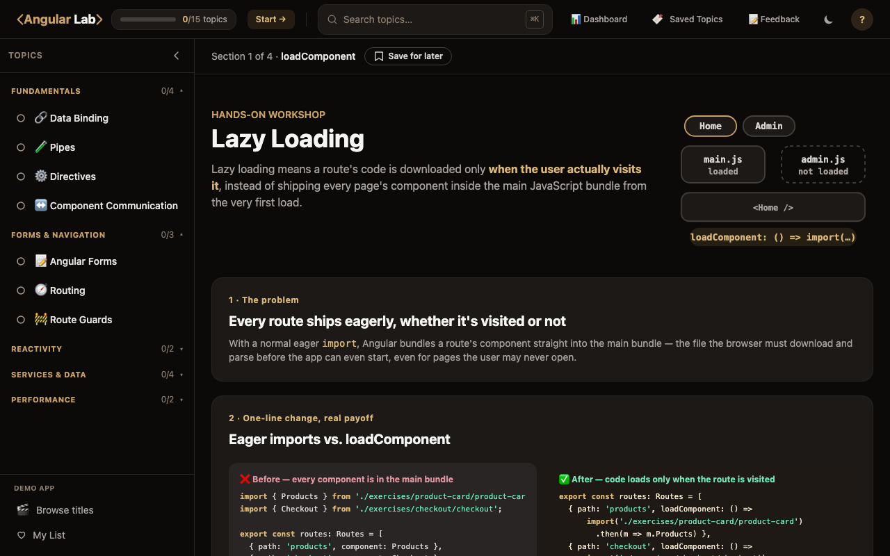

<div align="center">

# Angular Lab

**A hands-on playground for learning Angular — every core concept as a live, interactive page, not a slide.**

[**Live demo →**](https://youssefezzat17.github.io/angular-lab/)


[](https://github.com/YoussefEzzat17/angular-lab/actions/workflows/deploy-github-pages.yml)


</div>

---

## Overview

Angular Lab teaches Angular through **15 lessons**. Each lesson is split into short sections and closed by a final quiz. Each one explains *why* a concept exists and what problem it solves, shows a small animated diagram of what is actually happening, and gives you a live example you can click, edit and watch update in the browser. A small movie-and-series **demo app** shows several of these concepts working together in one real feature.

It is built with modern Angular only: standalone components, signals, the `@if` / `@for` / `@switch` control flow and signal inputs — no NgModules. There is no backend; everything runs in the browser.

## Features

- **15 interactive lessons**, each split into short sections (concept, try-it or reference, with a minutes estimate) and an overview page that lists the objectives and your progress.
- **Final quiz per topic** — 6 questions drawn at random from the topic's question bank, with shuffled answer choices. You need 75% to pass, your best score is kept, and the quiz stays locked until every section is done.
- **Progress tracking** — finishing a section marks it done and quiz results are recorded, all saved in `localStorage`. Progress saved in the old format is migrated automatically.
- **Dashboard** — welcome message with your name, a day streak, an overall progress ring and a per-topic progress map.
- **Save for later** — bookmark any lesson section; saved sections are listed on the Saved Topics page, and saving or removing one shows a toast.
- **Onboarding** — a first-visit dialog asks for an optional name, which appears as initials in the navbar avatar.
- **Sidebar and mobile navigation** — on desktop, a collapsible sidebar holds the grouped curriculum and demo-app links, and collapses to an icon rail. On phones, a fixed bottom bar (Home / Topics / Demo / Saved) replaces it, and Topics opens the curriculum in a bottom sheet.
- **Light and dark themes** built on CSS variables, so every colour follows the theme (toggle in the navbar; respects the system preference).
- **Command palette** — press <kbd>⌘</kbd>/<kbd>Ctrl</kbd> + <kbd>K</kbd> to jump to any topic or demo page.
- **Grouped navigation** — lessons are organised into five groups in the sidebar, the Topics menu and on the home page.
- **Demo app** — browse titles, keep a persistent **Watchlist** (with duplicate detection and a remove / clear-all page) and a **My List** of favourites; both survive a refresh.
- **Toast notifications** with success / error / info styles, a countdown bar and pause-on-hover.
- **Feedback form** that sends a real email through [EmailJS](https://www.emailjs.com/) (client-side, public key only).
- **Accessible and responsive** — keyboard navigable, `prefers-reduced-motion` respected, works down to phone width.

<div align="center">


</div>

## Lessons

The lessons are grouped, and the order below is the recommended learning path (it is also what Next / Previous follow).

| Group | Topic | Route | What you learn |
| --- | --- | --- | --- |
| **Fundamentals** | Data Binding | `/learn/binding` | Interpolation, property, event and two-way binding |
| | Pipes | `/learn/pipes` | Formatting dates, prices and text in templates, plus a custom pipe |
| | Directives | `/learn/directives` | `@if` / `@for` (and the older `*ngIf` / `*ngFor`), custom attribute directives |
| | Component Communication | `/learn/communication` | `@Input()` / `@Output()`, parent ↔ child with animated data-flow arrows |
| **Forms & Navigation** | Angular Forms | `/learn/forms` | Template-driven vs. reactive forms, validation |
| | Routing | `/learn/routing` | Routes, `router-outlet`, `routerLink`, route parameters |
| | Route Guards | `/learn/guards` | `canActivate`, redirecting with a `UrlTree`, and the other guard kinds (live login demo) |
| **Reactivity** | Signals | `/learn/signals` | `signal()`, `computed()`, `effect()` |
| | RxJS | `/learn/rxjs` | Observables, operators (`map`, `filter`, `switchMap`, `debounceTime`), memory leaks, the `async` pipe |
| **Services & Data** | Dependency Injection | `/learn/di` | `inject()`, `providedIn: 'root'` vs. component `providers` — one shared instance vs. one each |
| | Fetch API & HTTP | `/learn/movies` | `HttpClient`, services, a real public API |
| | HttpInterceptor | `/learn/interceptor` | One checkpoint for every request and response (e.g. attaching a token) |
| | Facade Pattern | `/learn/facade` | One simple front door over several services: build one, use it, test it, and when *not* to (live checkout demo with rollback) |
| **Performance** | Change Detection | `/learn/change-detection` | Default vs. `OnPush`, mutating vs. replacing, and why signals fit `OnPush` |
| | Lazy Loading | `/learn/lazy-loading` | `loadComponent` and smaller initial bundles |

Each lesson has its own overview at `/learn/<id>`, and its sections at `/learn/<id>/<section>`. The quiz is at `/learn/<id>/quiz` and opens only after all sections are done. `/learn` opens the first lesson, and the old paths (such as `/binding`) redirect to `/learn/<id>`.

**Demo app:** `/products` (browse titles) · `/products/:id` (details) · `/watchlist` · `/favorites`. **Also:** `/dashboard` (progress), `/bookmarks` (Saved Topics), `/guards/members` (guard demo), `/feedback`. The home page is at `/`.

## Tech stack

| | |
| --- | --- |
| Framework | Angular 20 — standalone components, signals, signal inputs, new control flow |
| Language | TypeScript 5.8 |
| Styling | Tailwind CSS 3 with CSS-variable design tokens (light / dark) |
| Reactive | RxJS 7.8 and Angular Signals |
| Email | `@emailjs/browser` |
| Testing | Jasmine + Karma |
| Hosting | GitHub Pages, deployed by GitHub Actions |

## Getting started

**Requirements:** Node.js 22+ and npm.

```bash
git clone https://github.com/YoussefEzzat17/angular-lab.git
cd angular-lab
npm install
npm start          # http://localhost:4200
```

The app reloads on every save — change a component and watch the concept it teaches update live.

| Command | What it does |
| --- | --- |
| `npm start` | Dev server on `http://localhost:4200` |
| `npm run build` | Production build into `dist/angular-lab/` |
| `npm test` | Unit tests (Karma + Jasmine) |
| `npm run build:gh-pages` | Production build plus the `404.html` / `.nojekyll` files GitHub Pages needs |

### Feedback form (optional)

The feedback page sends mail through EmailJS. Its service ID, template ID and **public** key live in `src/app/core/services/feedback.service.ts`. To use your own account, replace those three values. Never put a private key in client code.

## Project structure

```text
src/app/
├── core/
│   ├── data/          topics.ts — single source of truth for every lesson (sections, objectives, group)
│   │   └── quizzes/   one question bank per lesson
│   ├── guards/        members.guard.ts — the guard used by the Route Guards lesson
│   ├── layout/        site layout for the home and 404 pages (navbar, footer), toast, command palette
│   ├── models/        learning.models.ts (topics, sections, quizzes, progress), Movie, Product, User
│   ├── onboarding/    first-visit dialog that asks for an optional name
│   └── services/      progress, quiz, learning.facade, profile, bookmark, sidebar-state,
│                      progress-migration, theme, toast, watchlist (cart), favorites,
│                      feedback, movie, product, search palette, safe-storage
├── learn/             the lesson system
│   ├── layout/        learn layout with the top navbar and footer
│   ├── sidebar/       curriculum tree and sidebar parts
│   ├── player/        topic overview, lesson player, section navigation bar
│   ├── quiz/          final quiz, quiz result and topic-complete pages
│   ├── learn.routes.ts   /learn/:topic routes and the lesson page loaders
│   └── learn.guards.ts   quizUnlockedGuard, which locks the quiz until all sections are done
├── pages/             one folder per lesson, plus the home, dashboard, bookmarks,
│                      demo (products, product-details, watchlist, favorites, movies, feedback),
│                      guards/members and not-found pages
├── shared/            reusable UI: page-header, lesson-card, recap, knowledge-check, topic-nav,
│                      topic-illustration, progress-ring, flow-arrow, flow-diagram, icon,
│                      code-block directive
├── directives/        custom attribute directives used in the lessons
└── pipes/             custom pipes used in the lessons
docs/                  workshop blueprint and slide deck, README screenshots
```

A few design decisions worth knowing:

- **One list of topics.** `core/data/topics.ts` drives the sidebar, the navbar, the command palette, the home page, the section lists, the objectives and progress tracking. The routes and legacy redirects are generated from it. To add a lesson:
  1. Add a `Topic` entry (id, group, `legacyPath`, `sections`, `objectives`) to `topics.ts`.
  2. Add its id to the `TopicId` type in `core/models/learning.models.ts`.
  3. Add its page component to `TOPIC_LOADERS` in `learn/learn.routes.ts`.
  4. Add a question bank in `core/data/quizzes/` and register it in `QUIZ_BANK_LOADERS` in `core/services/quiz.service.ts`.
- **Theme tokens, not hard-coded colours.** Colours are CSS variables defined in `src/styles.css` and mapped into Tailwind, so light and dark share the same classes.
- **Safe persistence.** Progress, saved sections, watchlist, favourites, profile and sidebar state go through `safe-storage.ts`, which never throws if storage is blocked or the saved JSON is corrupt.

## Deployment

Every push to `main` runs `.github/workflows/deploy-github-pages.yml`: it installs dependencies, runs the unit tests, builds with the production configuration (base href `/angular-lab/`) and publishes to GitHub Pages. A copy of `index.html` is saved as `404.html` so deep links such as `/angular-lab/learn/signals` still resolve to the single-page app.

## Contributing

1. Create a branch from `main`.
2. Make your change and run `npm test` and `npm run build`.
3. Open a pull request describing what changed and why.

`.github/workflows/ci.yml` runs the same unit tests (in headless Chrome) and a production build on every pull request and on pushes to branches other than `main`.

## Author

Built by **Youssef Ezzat** — [Portfolio](https://youssef-ezzat.vercel.app/) · [GitHub @YoussefEzzat17](https://github.com/YoussefEzzat17).

## Resources

- [Angular documentation](https://angular.dev)
- [Angular CLI reference](https://angular.dev/tools/cli)
- [Tailwind CSS](https://tailwindcss.com/docs)
- [RxJS](https://rxjs.dev)
